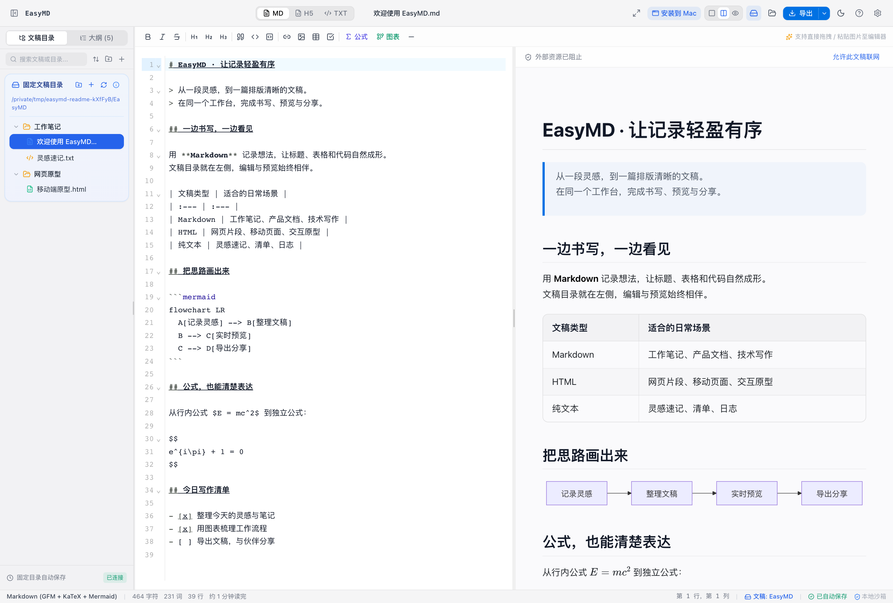
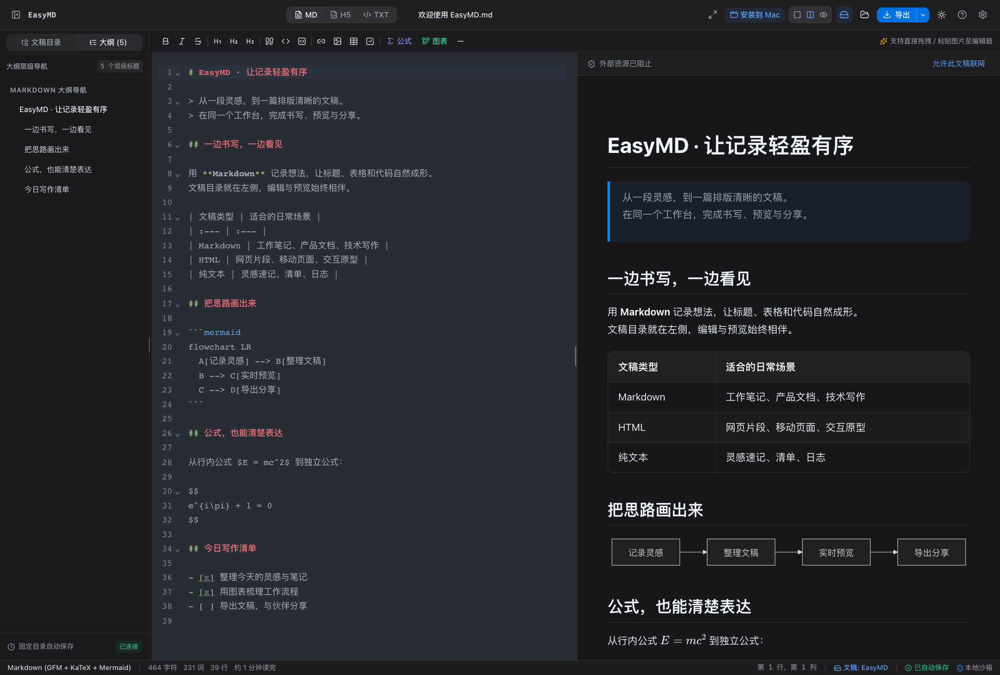
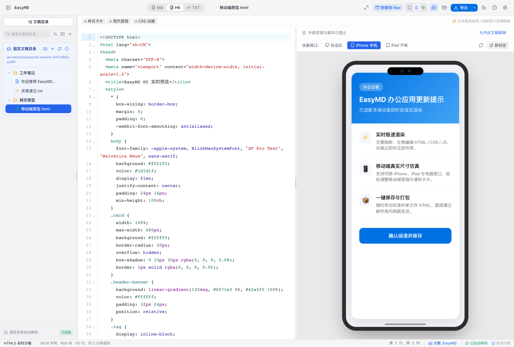
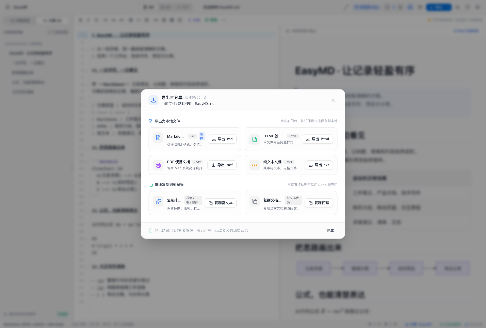

# EasyMD

面向桌面浏览器的 Markdown、HTML 与纯文本编辑器，采用 macOS 风格界面。



## 界面预览

以下为示例文稿的实际运行截图，点击图片可查看原图。

| 深色主题与大纲 | HTML 手机视口预览 | 导出与分享 |
| :---: | :---: | :---: |
| [](./assets/screenshots/markdown-dark.png) | [](./assets/screenshots/html-mobile-preview.png) | [](./assets/screenshots/export-center.png) |
| Markdown 编辑、图表与公式排版 | 编写 HTML，切换设备视口查看效果 | 导出文稿、打印为 PDF、复制富文本 |

## 固定文稿目录

本机模式默认把文稿固定保存到 **文稿 / EasyMD**（`~/Documents/EasyMD`），打开应用即可使用，无需每次选择文件夹，也不要求启用 iCloud。目录树只显示这个工作目录中的文稿及子文件夹；支持 `.md`、`.markdown`、`.html`、`.htm`、`.txt` 和 `.log`。

程序不会自动猜测、切换或启用 iCloud。以后需要改用 iCloud 时，先在系统设置中启用云盘、等待 Finder 可用，再显式运行 `node scripts/install-macos.mjs --icloud`。此模式只识别已存在的正式云盘目录（通常为 `~/Library/Mobile Documents/com~apple~CloudDocs`，也支持明确的 `~/Library/CloudStorage/iCloudDrive`），并使用其 `EasyMD` 子目录。未启用时会明确报错，**不会选择带日期的归档目录，也不会创建缺失的 iCloud 父目录来冒充同步位置**。

首次连接本机服务时，会把已有浏览器草稿复制到固定目录。同名文件不会被覆盖，发生冲突时会使用独立名称；复制失败时保留原草稿。后续保存采用版本检查，检测到外部修改后会保留草稿并提示冲突。

单篇文稿上限 **2 MiB**，每个文件夹最多 **2000 项**，最大路径深度 **16 层**。文件夹列表读取总量限制为 **32 MiB**。打开文件、插入图片时会检查大小；图片以 Base64 内嵌后的实际大小也计入上限。编辑器只接受拖入图片，其他文件请使用“打开文件”导入新文稿，避免覆盖当前内容。TXT 模式不插入图片。

删除会把文稿放入固定目录的 `.trash/`，不会直接永久删除。每个回收项包含 `metadata.json`（原路径与删除时间）和 `entry`（原文件或文件夹）。本机接口支持恢复且不会覆盖已存在目标；也可以退出应用后在访达中显示隐藏文件，按记录把 `entry` 移回所需位置。请勿把 `.trash` 当作长期备份。

默认安装仅操作本机文稿目录。如果用户已开启 macOS 的“桌面与文稿文件夹”iCloud 同步，`~/Documents/EasyMD` 也可能由系统同步；跨设备上传和下载由 Apple 服务处理，本机写入成功不代表其他设备已收到。显式切换 iCloud 后，关闭云盘、退出 Apple 账户、同步暂停或占位文件尚未下载都可能使目录暂时不可访问，应用会保留浏览器草稿并提示错误。

## 安装与启动

使用 Node.js 22.15 或更新版本和 pnpm 10。

```bash
pnpm install --frozen-lockfile
pnpm build
pnpm desktop:install
```

安装器使用本机后台服务承载生产构建，保留应用的 `5173` 端口。默认服务地址为 [http://127.0.0.1:5173/](http://127.0.0.1:5173/)，可从浏览器安装为 PWA。不要同时在这个端口运行 Vite 开发服务。

手动启动而不安装后台服务：

```bash
pnpm desktop:serve
# 需要时显式指定固定工作目录或构建目录（工作目录的父目录必须已存在）：
pnpm desktop:serve --root /absolute/path/to/EasyMD --dist /absolute/path/to/dist --port 5173
```

工作目录只由服务启动参数决定，网页接口不能更改它。服务只监听 `127.0.0.1`，检查准确的 Host、Origin、同源 Fetch Metadata、自定义客户端标记与随机会话令牌；拒绝跨域预检、路径逃逸、隐藏路径、符号链接及硬链接。文件写入使用版本检查和原子替换，重名创建与重命名不覆盖已有文件。静态页面禁止被外站框架嵌入。

这些边界用于保护本机网页接口，不是针对已经拥有当前系统用户文件权限的其他本机程序的隔离机制。

## 开发与验证

```bash
pnpm dev
```

开发地址为 [http://127.0.0.1:5174/](http://127.0.0.1:5174/)，独立于已安装应用的 `5173` 端口，且不注册 Service Worker。开发服务器没有本机文件 API；该地址使用自己的浏览器草稿。

```bash
pnpm test
pnpm build
pnpm preview
```

`pnpm test` 使用 Node 自带测试运行器，包含真实临时目录和本机 HTTP 服务集成回归；运行环境需允许监听回环地址。启动开发服务后，还可访问 `/tests/rendering.browser.html`、`/tests/editor.browser.html` 和 `/tests/privacy.browser.html`，运行真实浏览器中的渲染、导出、拖拽及隐私隔离回归。这些测试页不读写已有文稿，也不会打开系统打印窗口。

## 纯网页部署与离线使用

也可以把 `dist/` 的全部文件部署到普通静态网站。**纯网页部署没有本机目录 API，只提供当前浏览器中的草稿、导入和导出**；它不能静默读写电脑上的固定目录。正式网站应使用 HTTPS。

默认部署在网站根目录，子目录部署可以在构建时指定：

```bash
BASE_URL=/EasyMD/ pnpm build
```

构建自动生成第三方许可文件，以及包含 JS、CSS、字体、动态图表模块的离线缓存清单。首次安装必须联网并等完整资源缓存完成，更新会在旧版本窗口关闭后生效。离线应用仍需本机文稿服务运行才能读写固定目录；服务停止时，编辑内容保留为浏览器草稿。远程图片、链接和用户 HTML 中的网络请求不在离线保证范围内。

## 其他功能与数据边界

- 文件与文件夹管理、搜索、排序和文档大纲；Markdown 支持 GFM、KaTeX、Mermaid 与代码高亮。
- Markdown 默认阻止外部图片及其他被动资源；Mermaid 的普通流程图、时序图、类图与 ER 图可离线渲染，其他图表类型、图片节点、自定义样式、配置与扩展语法需先允许联网。
- HTML 默认以禁用脚本、表单提交和外部资源的隔离预览显示，支持手机/平板视口与独立预览窗口。预览中的“允许此文稿联网”需要确认，只对本次打开应用期间的该篇文稿生效；刷新或重新打开应用后恢复阻止。允许后，HTML 脚本可以运行并向外部服务发送该文稿中的内容，请仅授权可信文稿。点击“停止联网”或删除该文稿会关闭其已授权独立预览和正在进行的打印预览，关闭原应用窗口也会关闭已授权独立预览。
- Markdown、HTML、TXT 导出，以及浏览器打印/另存为 PDF。独立预览、打印、富文本复制和 Markdown 的 HTML 导出遵守当前文稿的联网授权。默认复制 HTML 文稿时会移除脚本、外部资源与 CSS，防止粘贴目标绕过预览限制。Markdown HTML 导出内嵌应用样式、公式字体和已渲染图表；外部资源不会自动打包。
- **原始 Markdown、HTML 和 TXT 文件导出保留文稿源码。** 独立打开导出的 HTML，或把源码交给其他软件运行，可能执行脚本或访问网络；应用内授权不约束这些外部程序。
- 源码与富文本复制；粘贴排版取决于目标应用。PDF 分页和字体取决于浏览器与打印设置。
- 浏览器草稿和磁盘文稿未进行应用层加密。清除网站数据会影响草稿，重要内容请定期备份。
- 支持 Web Locks 的浏览器仅允许一个窗口编辑，其他窗口只读；关闭原编辑窗口后刷新另一个窗口。没有 Web Locks 的浏览器请只开一个编辑窗口。
- 应用未集成使用统计、广告或文稿上传服务。默认预览阻止文稿外部资源；用户主动点击 Markdown 外链，或允许该文稿联网后加载资源，会访问对应服务并暴露网络地址。macOS 可能按用户已有设置同步文稿目录，显式选择的 iCloud 目录由 Apple 服务同步。联网授权不能撤回已经发出的请求。

## 开源与许可证

EasyMD 原创代码和项目自绘图标以 [MIT 许可证](./LICENSE) 发布，版权署名为 `Copyright (c) 2026 Xchat1`。生产构建携带 `LICENSE.txt` 并纳入离线缓存，macOS 安装包同样保留该文件。

应用图标采用项目内全新绘制的几何矢量源 [assets/app-icon.svg](./assets/app-icon.svg)，已替换来源无法核实的旧位图。设计来源、衍生文件与重新生成方法见 [素材来源记录](./assets/ASSET_SOURCES.md)。MIT 授权不改变第三方组件、字体或用户自行导入素材的许可证。

第三方组件保留各自许可证。完整声明见 [THIRD_PARTY_NOTICES.md](./THIRD_PARTY_NOTICES.md)，构建时也复制到 `dist/`。清单覆盖锁文件对应的已安装运行时依赖、传递依赖与 peer 依赖；缺失完整许可或版本未核验时构建失败。KaTeX 软件使用 MIT，字体另受 SIL OFL 1.1 约束；HTML 导出保留对应字体和样式声明。

```bash
pnpm licenses:generate
pnpm audit
```

漏洞审计依赖实时的外部服务，应以每次成功返回的结果为准。MIT 是使用与分发许可，不是安全或隐私认证。`package.json` 的 `private: true` 用于防止误发布到 npm，不影响 MIT 授权。

## 技术栈

React、TypeScript、Vite、Tailwind CSS、CodeMirror、Marked、DOMPurify、KaTeX、Mermaid、Highlight.js、Lucide；本机文件服务只使用 Node.js 核心模块。
